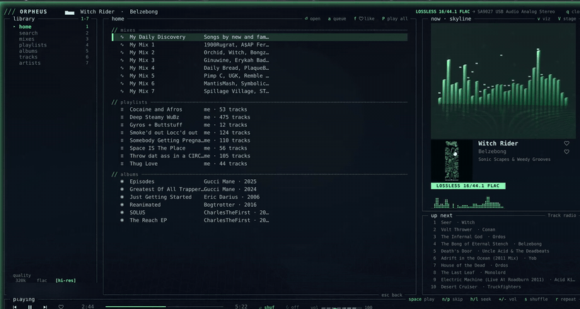
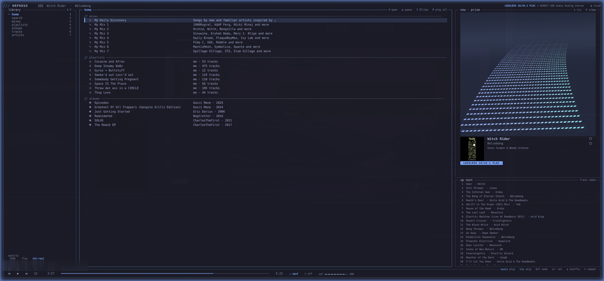
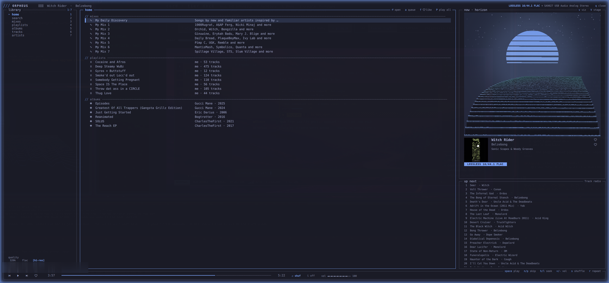
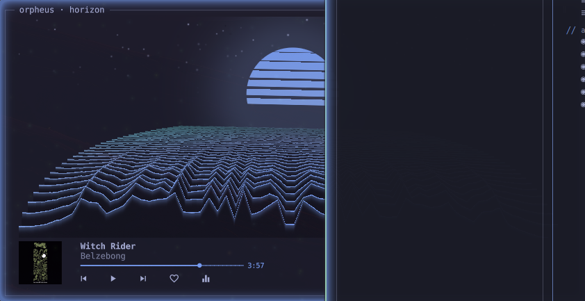

<div align="center">

```
█████ ████  ████  █   █ █████ █   █ █████
█   █ █   █ █   █ █   █ █     █   █ █
█   █ ████  ████  █████ ████  █   █ █████
█   █ █  █  █     █   █ █     █   █     █
█████ █   █ █     █   █ █████ █████ █████
```

**a hi-res TIDAL player that thinks it's a terminal**

[](LICENSE)
[](manifest.json)
[](https://omarchy.org)
[](#-how-it-fits-together)
[](https://github.com/GeneralDussDuss/orpheus/stargazers)

**[Live demo — the real shaders, running in your browser](https://generaldussduss.github.io/orpheus-site/)**

</div>



---

## ╱╱ the idea

Most music visualizers react to **loudness**. A kick lands, the bars jump, and that is
the whole relationship. Orpheus reacts to **pace**: it estimates the tempo of what is
playing and moves the world at that speed. A 174 BPM breakbeat does not just flicker
harder than a 89 BPM doom riff — the road arrives sooner, the camera covers more ground,
the terrain rolls past faster.

The shaders never read the clock. They read a distance that the CPU integrates from the
current tempo, so when the pace changes, the world's speed changes with it.

The other half of the idea is that none of it looks like a music app. There is no title
bar, there are no rounded cards and there are no popout menus. The interface is
box-drawing characters and braille spectrum glyphs laid out in the columns and rows of
your desktop font, with a fragment shader running in the right half of the window.
Colours come from the active Omarchy theme, so it changes when your desktop does.

<table>
<tr>
<td width="50%"></td>
<td width="50%"></td>
</tr>
<tr>
<td align="center"><b>Prism</b> — a spectrum city on a winding road</td>
<td align="center"><b>Horizon</b> — ridgelines rolling out of a banded sun</td>
</tr>
</table>

> **Unofficial client.** Orpheus is not affiliated with, endorsed by or supported by
> TIDAL. It uses the unofficial [`tidalapi`](https://github.com/tamland/python-tidal)
> library and needs **your own paid TIDAL subscription**. It only streams; it does not
> download, store or decrypt anything. TIDAL's terms may not permit third-party clients.
> Whether to use one on your account is your call and your risk.

---

## ╱╱ contents

- [What you get](#-what-you-get)
- [How it fits together](#-how-it-fits-together)
- [Requirements](#-requirements)
- [Install](#-install)
- [Sign-in](#-sign-in)
- [Keybinds and usage](#-keybinds-and-usage)
- [Equalizer](#-equalizer)
- [Configuration](#-configuration)
- [Troubleshooting](#-troubleshooting)
- [Status and known issues](#-status-and-known-issues)
- [Licence](#-licence)

---

## ╱╱ what you get

| | |
|---|---|
| **The player** | A TUI window with your mixes, playlists, albums, tracks and artists, a search, a queue, and a visualizer in the right-hand rail. `Super+Shift+M`. |
| **The stage** | The same engine fullscreen, with a mini-player. `Super+Ctrl+M`. |
| **The widget** | A desktop widget that cycles styles inline — no popout. Five layer modes: `top`, `reserve`, `desktop`, `tile`, `float`. |
| **The bar** | A tiny always-on spectrum in the Omarchy bar. Click for the stage, scroll for the next style. |
| **Five styles** | Prism, Skyline, Horizon, Tunnel, Orb — plus `mini` for bar-sized surfaces, and a GPU spectrum-history pass the first two build terrain from. |
| **Hi-res** | Up to FLAC hi-res through the PKCE sign-in, lossless otherwise. The player shows which you got. |
| **Desktop integration** | MPRIS, so your bar, your media keys and the rest of the desktop see the track. Favourites from anywhere in the UI. The queue and position survive a service restart. |



---

## ╱╱ how it fits together

Two halves that talk over a loopback socket.

```
   TIDAL ──tidalapi──┐
                     │
                 ┌───▼──────────────────────┐        ┌──────────────────────┐
                 │  orpheusd  (Python)      │  JSON  │  Quickshell plugin   │
                 │                          │◄──────►│  (QML + GLSL)        │
                 │  · tidalapi session      │  :47837│                      │
                 │  · mpv over JSON IPC     │        │  · Library / Stage   │
                 │  · MPRIS over dbus-next  │        │  · Widget / BarWidget│
                 │  · queue + resume.json   │        │  · 7 fragment shaders│
                 └───┬──────────────────────┘        └──────────▲───────────┘
                     │                                          │
                    mpv ──► PipeWire ──────────► cava ──────────┘
                                                 32 bands @ 30/60 Hz
```

- **`orpheusd/`** — the daemon. `tidal.py` owns the session and the catalogue, `player.py`
  drives `mpv` over its JSON IPC (launched `--load-scripts=no --media-controls=no` so
  mpv's own MPRIS stays out of the way), `mpris.py` publishes the standard interface.
  It serves a long-polling `/status` plus `/play`, `/control/*`, `/favorite`, `/liked`
  and `/login/*` on `127.0.0.1:47837`.
- **`*.qml`** — the shell plugin. `Service.qml` is the always-on half: it runs `cava`,
  detects beats, reads theme colours live and registers the IPC handler. `Library.qml` is
  the player window, `Stage.qml` the fullscreen one, `Widget*.qml` the desktop widget,
  `BarWidget.qml` the bar spectrum, `Viz.qml` the shader host.
- **`shaders/`** — the GLSL. `_common.glsl` is inlined at each `//#common` line by
  `build-shaders.sh`; `history.frag` is a feedback pass that keeps a 32×40 spectrum
  history on the GPU so Prism and Horizon can build terrain out of the past.

Tempo is estimated by autocorrelating the spectral-flux envelope at a fixed 50 Hz. The
octave is chosen against a target derived from onset density, with a veto on any
candidate that would imply more than 3.5 onsets per beat — that is what stops a dense
breakbeat locking to half-time.

---

## ╱╱ requirements

- [Omarchy](https://omarchy.org) with Hyprland and its Quickshell-based shell
  (`omarchy-shell` must be on `PATH`)
- `cava` (the visualizers read the PipeWire monitor, so PipeWire is expected)
- `mpv`
- Python 3.12 or newer
- [`uv`](https://docs.astral.sh/uv/)
- A paid TIDAL subscription
- To rebuild shaders only: `qsb` from Qt 6 shader tools. The compiled `shaders/*.qsb`
  files are committed, so a normal install does not need it.

Orpheus has only been run on one machine (Arch-based Omarchy, Hyprland 0.56). If you get
it working somewhere else, or it breaks, an issue is genuinely useful.

---

## ╱╱ install

`orpheusd.service` runs `%h/Work/orpheus/.venv/bin/orpheusd`, so the steps below clone
there. **Clone somewhere else and you must edit the `ExecStart=` line.**

```sh
# 1. get the source
git clone https://github.com/GeneralDussDuss/orpheus ~/Work/orpheus
cd ~/Work/orpheus

# 2. python environment (creates .venv from pyproject.toml / uv.lock)
uv sync

# 3. the daemon, as a systemd *user* service
mkdir -p ~/.config/systemd/user
ln -s ~/Work/orpheus/orpheusd.service ~/.config/systemd/user/orpheusd.service
systemctl --user daemon-reload
systemctl --user enable --now orpheusd.service

# 4. the shell plugin
ln -s ~/Work/orpheus ~/.config/omarchy/plugins/orpheus

# 5. optional: the launcher and its desktop entry
ln -s ~/Work/orpheus/bin/orpheus ~/.local/bin/orpheus
cp share/applications/orpheus.desktop ~/.local/share/applications/

# 6. restart the shell -- plugins are not hot-reloaded
omarchy restart shell
```

**Enable the bar widget.** The plugin is picked up from
`~/.config/omarchy/plugins/orpheus`, and its manifest declares a bar widget. Add
`{ "id": "orpheus" }` to the section you want in `~/.config/omarchy/shell.json`, then
restart the shell again. Only the bar-layout entry has been verified on a clean install;
if your Omarchy build needs anything else, please open an issue and say so.

The shell does not hot-reload plugins, so a restart is needed after install and after any
change to the QML.

### Rebuilding the shaders

`shaders/*.frag` are compiled to `.qsb` by `build-shaders.sh`, which inlines
`shaders/_common.glsl` at each `//#common` line and runs `qsb --qt6`.

`qsb` ships with Qt 6's shader tools. On Arch it is in `qt6-shadertools` and installs to
`/usr/lib/qt6/bin/qsb`, which is **not on `PATH`**. The script falls back to that path on
its own; for anywhere else, set `QSB`:

```sh
./build-shaders.sh
QSB=/path/to/qsb ./build-shaders.sh
```

The std140 uniform block in `_common.glsl` must match `Viz.qml` exactly, or the
visualizer renders black.

---

## ╱╱ sign-in

Press `Ctrl+Shift+O` (once bound, see below), or run `orpheus login`. The sign-in page
offers two flows:

- **Standard sign-in** (a device link). This streams at most lossless FLAC.
- **Hi-res sign-in** (`h`, PKCE). It opens a TIDAL login in your browser, and you paste
  the redirect URL back into the page. **Hi-res streaming only works with this flow**:
  the daemon reports `hires` only when the session is a PKCE session, and otherwise falls
  back to lossless.

The page shows `signed in as <user> · hi-res unlocked` when it worked. The session is
kept in `~/.local/state/orpheus/tidal-session.json` — treat that file as a credential.

---

## ╱╱ keybinds and usage

Orpheus does not install keybinds. Add them yourself; the author's
`~/.config/hypr/bindings.lua` has:

```lua
o.bind("SUPER + SHIFT + M", "Music", "omarchy-shell -q orpheus library")
o.bind("SUPER + CTRL + M", "Music visualizer", "omarchy-shell -q orpheus toggle")
o.bind("SUPER + ALT + M", "Music widget", "omarchy-shell -q orpheus widget enabled toggle")
o.bind("CTRL + SHIFT + O", "Orpheus sign-in", "omarchy-shell -q orpheus login")
```

| key | |
|---|---|
| `Super+Shift+M` | the player |
| `Super+Ctrl+M` | fullscreen stage |
| `Super+Alt+M` | the desktop widget |
| `Ctrl+Shift+O` | sign-in |

In the player: `v` cycles the visualizer plane, `V` opens the stage, `1`–`7` switch tabs
(home, search, mixes, playlists, albums, tracks, artists), `↵` plays, `space` pauses,
`f` favourites, `/` searches, `q` closes.

**CLI.** `bin/orpheus [open|stage|close|toggle|status]` is idempotent: `open` and `close`
check state first, `toggle` flips the player, `status` prints the shell's status JSON.
Everything is an IPC call; nothing is launched or kept alive. That is what makes it safe
for a `.desktop` entry, which a launcher may fire twice.

**The desktop widget** is configured through one method, `widget <key> <value>`:

| key | values |
|---|---|
| `enabled` | `on` · `off` · `toggle` |
| `style` | `compact` · `full` |
| `corner` | `top-left` · `top-right` · `bottom-left` · `bottom-right` |
| `layer` | `top` · `reserve` · `desktop` · `tile` · `float` |
| `viz` | `prism` · `skyline` · `horizon` · `tunnel` · `orb` |
| `monitor` | a monitor name, or empty for wherever it lands |

`layer` is the one that decides how it behaves: `desktop` pins it behind your windows like
a wallpaper, `tile` makes it a real window Hyprland lays out, `float` floats it, `top`
sits above everything and `reserve` carves out space for it. Settings persist, so you set
them once. Styles also cycle on the widget itself — scroll it or right-click — because
this player does not do popout menus.

Or call the shell directly — `omarchy-shell orpheus <method>` — with methods
`status toggle show hide library login style railViz nextRailViz nextStyle miniPlayer
placement widget`. Note the widget's visualizer is `widget viz <style>`; there is no
`widgetViz`.

---

## ╱╱ equalizer

Ten bands at 31, 62, 125, 250, 500&nbsp;Hz and 1, 2, 4, 8, 16&nbsp;kHz, ±12&nbsp;dB in half-decibel
steps. The two end bands are shelves rather than peaks, because a peaking filter at 31&nbsp;Hz
with Q&nbsp;1.4 has almost no effect by 20&nbsp;Hz — "lift the sub-bass" should do what it says.

It runs inside mpv as a filter chain, not as a PipeWire sink. That means it follows the
output device automatically, affects nothing but Orpheus, and adds no dependency. **A flat
or disabled EQ removes the filter entirely**, so the signal path is untouched rather than
running through a unity-gain biquad.

**Headroom is automatic.** Orpheus runs mpv with `--replaygain-clip=no`, so the signal is
already permitted above 0&nbsp;dBFS before the EQ touches it; boosting a band on top of that
clips in the final integer conversion where nothing can catch it. The preamp defaults to
minus the largest boost. You can override it, but you probably should not.

```sh
curl -s 127.0.0.1:47837/eq                  # bands, presets, current state
curl -X POST 127.0.0.1:47837/eq -d '{"preset":"loudness","enabled":true}'
curl -X POST 127.0.0.1:47837/eq -d '{"band":0,"gain":4.5}'   # one band, for a slider
curl -X POST 127.0.0.1:47837/eq -d '{"enabled":false}'       # bypass
```

Six tone presets ship with it: Flat, Bass Lift, Vocal, Loudness, Tame Treble and Speech.

### Headphone corrections

Orpheus ships **no measurement data**, deliberately. The obvious source is
[AutoEq](https://github.com/jaakkopasanen/AutoEq), whose MIT licence covers its code and
not its data — the measurements come from oratory1990, Rtings, Super Review and others, none
of whom have granted redistribution, and the maintainer confirms the distinction in AutoEq
issue [#790](https://github.com/jaakkopasanen/AutoEq/issues/790). So Orpheus ships the
importer instead, and the numbers stay on your machine.

Find your headphones in AutoEq's results, take the **`FixedBandEQ.txt`** (not
`ParametricEQ.txt` or `GraphicEQ.txt` — the fixed-band file is already fitted to these exact
ten centres) and post it:

```sh
curl -X POST 127.0.0.1:47837/eq/presets -H 'Content-Type: application/json' \
  --argjson text "$(jq -Rs . < 'Sennheiser HD 6XX FixedBandEQ.txt')" \
  -d "{\"name\":\"Sennheiser HD 6XX\",\"text\":$(jq -Rs . < 'Sennheiser HD 6XX FixedBandEQ.txt')}"
```

It lands in `~/.local/state/orpheus/eq-presets.json` and appears alongside the tone presets.
`DELETE /eq/presets/{id}` removes one.

One thing the importer will warn you about: AutoEq fits out to 20&nbsp;kHz, above the range
where coupler measurements are reliable, so the 16&nbsp;kHz band often comes out as a large cut
that is an artefact of the fit rather than anything you would hear. The warning is advisory —
your data is imported as written.

---

## ╱╱ configuration

Little is configurable, and most of it is by hand.

- **Audio quality** is picked in the player (`high` 320k, `lossless` FLAC, `hires`); the
  choice is stored in `~/.local/state/orpheus/daemon.json`.
- **The EQ curve** is stored in the same file and restored before the first track plays.
  Imported headphone corrections live beside it in `eq-presets.json`.
- **Port.** The daemon defaults to `47837`, settable with `--port` or `ORPHEUS_PORT`.
  `Api.qml` hardcodes `47837`, so changing the daemon's port also means editing the QML.
- **State**: `~/.local/state/orpheus/` (session, prefs, `resume.json` — the queue and
  position are restored on start). **Cache**: `~/.cache/orpheus/`. **mpv socket**:
  `$XDG_RUNTIME_DIR/orpheus/mpv.sock`.
- **Colours and font** follow the Omarchy theme and font. There is nothing to set.

---

## ╱╱ troubleshooting

- **Nothing happens on the keybind.** Check the plugin is loaded:
  `omarchy-shell orpheus status`. If it errors, the plugin symlink or the shell restart
  is missing.
- **Player opens but is empty or offline.** Check the daemon:
  `systemctl --user status orpheusd`, `journalctl --user -u orpheusd -e`. A quick probe
  is `curl -s 127.0.0.1:47837/status`.
- **Only lossless, no hi-res.** You signed in with the standard flow. Sign in again and
  press `h`.
- **No sound or no visualizer.** The visualizer reads PipeWire through `cava`; check
  `command -v cava mpv`. (Orpheus has nothing to do with your DAC — if the whole desktop
  is silent, that is elsewhere.)
- **The visualizer is flat while music is obviously playing.** Orpheus pins `cava` to the
  monitor of your *default sink* and follows it when you switch output. If it ever gets
  out of step, check which source `cava` actually grabbed:

  ```sh
  pactl get-default-sink                       # where audio is going
  grep '^source' ~/.local/state/orpheus/cava.conf   # where cava was told to listen
  pactl list source-outputs | grep -A6 cava    # where cava actually is
  ```

  Those three should agree. If the config says `source = auto`, `pactl` could not be
  reached and cava is guessing — that is the old behaviour, and it breaks as soon as you
  change output device.
- **Visualizer is a black rectangle after a shader edit.** Rebuild with
  `./build-shaders.sh` and restart the shell. A uniform-block mismatch between
  `_common.glsl` and `Viz.qml` is the usual cause.
- **Restarting `orpheusd` interrupts playback** for about a second; resume brings it back.

---

## ╱╱ status and known issues

Orpheus is a personal project. It has been run on one desktop, by one person, for a
couple of weeks. It works well enough that it is the author's daily player — and it has
sharp edges that only one machine's worth of testing can leave.

Honest list, at the time of writing:

- **Sparse drum & bass can still read at half-time.** The octave rule used to prefer the
  candidate nearest 120 BPM, which locked a ~174 BPM track to 86 and rendered it *slower*
  than rest pace. It now aims at a target derived from onset density and vetoes any
  candidate needing more than 3.5 onsets per beat, which fixes dense breakbeats. Around
  4 onsets/s the two readings are genuinely ambiguous and it can still pick half-time.
- **`tempoConfidence` measures peak sharpness, not correctness.** A confident reading is
  not necessarily a right one — a half-time lock produces a very sharp peak.
- **An intermittent crash when closing the stage.** Twice in one session, closing the
  stage took the whole shell down inside Qt's item destruction. It did not reproduce
  across 90 scripted open/close cycles, so the trigger is not known. Unresolved.
- **mpv's memory grows over a long session.** After 7¼ hours of playback mpv held 1.19 GB
  of anonymous heap with its demuxer cache at the stock 150 MiB the whole time, so
  buffering does not explain it. The budget is now capped at 48 MiB forward / 16 MiB
  back, which bounds the buffers but is not confirmed to be the cause. Restarting
  `orpheusd` reclaims it and resume restores the queue. Under investigation.
- **The plugin costs roughly 15% of shell CPU while playing.** One machine, eyeballed —
  not a benchmark.
- **Toggling the plugin off and on at runtime froze the shell once.** Teardown on unload
  has since been added, but the original freeze has not been reproduced to confirm the
  fix.
- **TIDAL is the only provider, on purpose.** Spotify cannot legally stream to a
  third-party client at all, and a provider abstraction for one provider costs more than
  it returns.

If you run it and something breaks, [open an issue](https://github.com/GeneralDussDuss/orpheus/issues).
If you like it, a ⭐ is how the author finds out anyone else is running it.

---

## ╱╱ licence

**[GPL-3.0-or-later](LICENSE).** It sits naturally on this stack: both Quickshell and
tidalapi are LGPL-3, so there is no compatibility friction.

The showcase site is a separate repo
([orpheus-site](https://github.com/GeneralDussDuss/orpheus-site), CC BY-SA 4.0) and
carries the screenshots, the motion clips and a browser port of these shaders you can
drive yourself.
