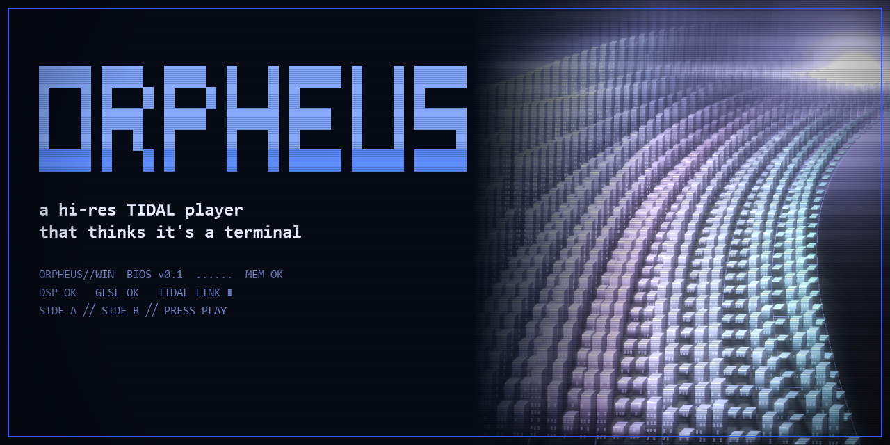
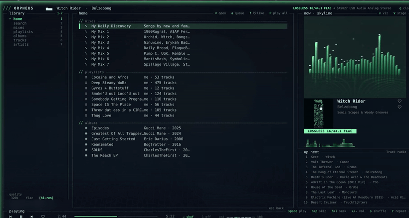
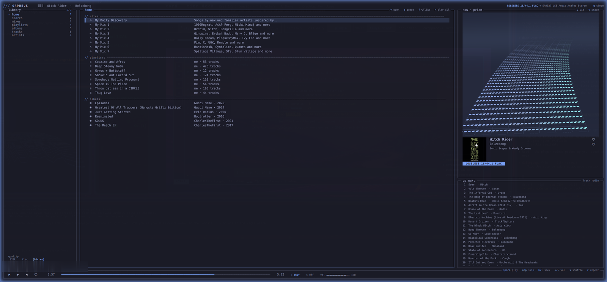
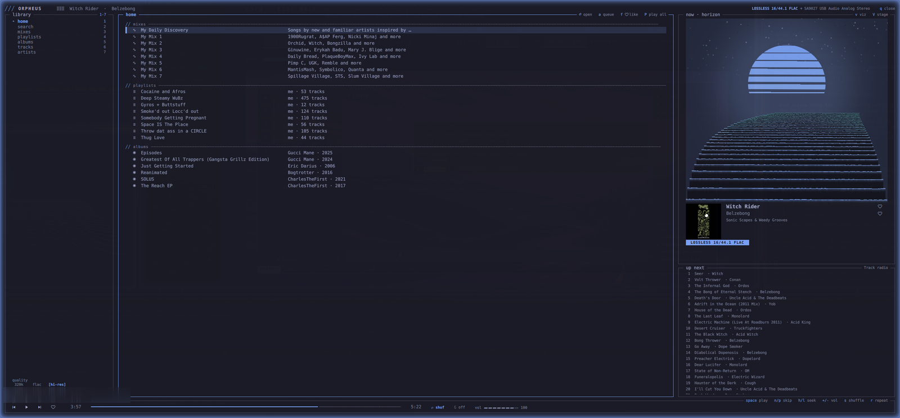
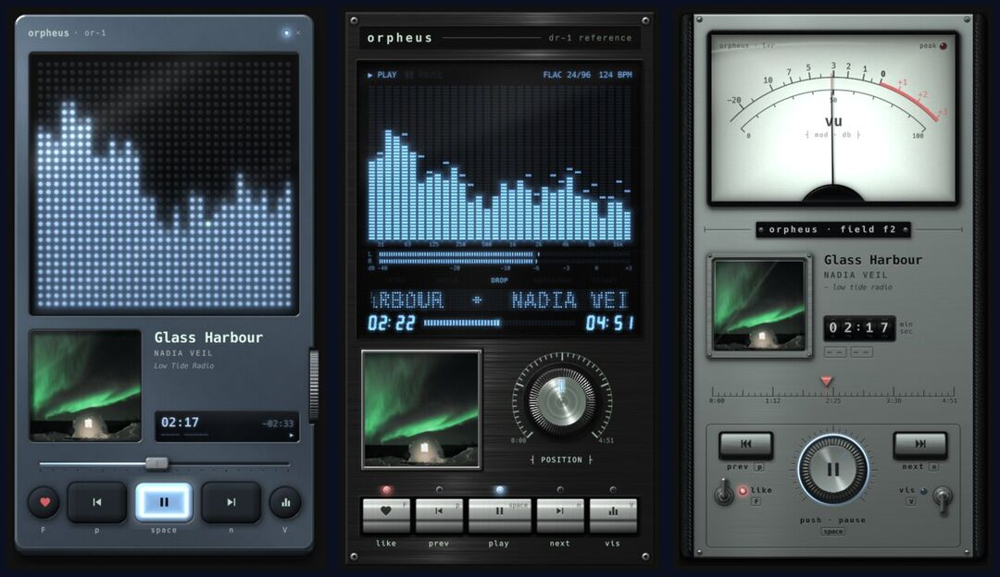

<div align="center">

<a href="docs/media/social.png"></a>

**a hi-res TIDAL player that thinks it's a terminal**

[](LICENSE)
[](manifest.json)
[](#requirements)
[](docs/architecture.md)
[](https://github.com/GeneralDussDuss/orpheus/stargazers)

**[▶ Live demo: the real shaders, running in your browser](https://generaldussduss.github.io/orpheus-site/)**

</div>

Orpheus is a music player and visualizer for the [Omarchy](https://omarchy.org) desktop (and Windows).
It plays TIDAL up to hi-res FLAC, your own Navidrome server, and SoundCloud and YouTube. The whole
interface is box-drawing characters in your desktop font and theme, with twenty GLSL visualizers that
move at the pace of the music, not its volume.



## Install

**Linux (Omarchy)**, in a terminal:

```sh
curl -fsSL https://raw.githubusercontent.com/GeneralDussDuss/orpheus/main/install.sh | bash
```

**Windows 10 / 11**, in PowerShell:

```powershell
irm https://raw.githubusercontent.com/GeneralDussDuss/orpheus/main/install.ps1 | iex
```

Either one is the whole install: it adds what is missing, sets everything up and opens the player.
Run the same line again to update. `install.sh --uninstall` (or Settings → Apps on Windows) removes
it and keeps your sign-in. What the scripts do, flag by flag: [docs/install.md](docs/install.md).

Then press `Super+Shift+M` for the player and `Ctrl+Shift+O` to sign in. *Insert cassette, press play.*

**First 60 seconds**

1. `Super+Shift+M` opens the player.
2. Sign in with `l`, or press `8` for YouTube and SoundCloud without TIDAL.
3. `/` to search, `space` to play.
4. `?` shows every key, `ctrl+k` every command.

## The idea

Most visualizers react to **loudness**: a kick lands, the bars jump, and that is the whole
relationship. Orpheus reacts to **pace**. It estimates the tempo of what is playing and moves the world
at that speed. A 174 BPM breakbeat does not just flicker harder than an 89 BPM doom riff: the road
arrives sooner, the camera covers more ground, the terrain rolls past faster.

The other half is that none of it looks like a music app. No title bar, no rounded cards, no popout
menus. Colours come from the active Omarchy theme, so it changes when your desktop does.

<table>
<tr>
<td width="50%"></td>
<td width="50%"></td>
</tr>
<tr>
<td align="center"><b>Prism</b>, a spectrum city on a winding road</td>
<td align="center"><b>Horizon</b>, ridgelines rolling out of a banded sun</td>
</tr>
</table>

> **Unofficial client.** Orpheus is not affiliated with, endorsed by or supported by TIDAL. It uses the
> unofficial [`tidalapi`](https://github.com/tamland/python-tidal) library and needs **your own paid
> TIDAL subscription**. It only streams; it does not download, store or decrypt anything. TIDAL's terms
> may not permit third-party clients. Whether to use one on your account is your call and your risk.

## What you get

- **The player** (`Super+Shift+M`): mixes, playlists, albums, tracks, artists, search, a queue, and a
  visualizer in the right-hand rail. Drag its top edge to move it.
- **The visualizer** (`Super+Ctrl+M`): the same engine fullscreen or as a floating card, with a mini player.
  Drag the card by its title; double-click to centre it. Pin the fullscreen show to a monitor in
  settings ▸ "show on screen".
- **Twenty styles**: Prism, Skyline, Horizon, Orb, Tunnel, Halo, Scope, Nova, Ink, Abyss, Aurora, Lens,
  Gyre, Nebula, Inferno, Teletype, Sanctum, Grid, Aether and Mandala. The visualizer reads the song's
  sections and lands style changes on the downbeat.
- **Drop detection**: each track (TIDAL or Navidrome) is analysed ahead so builds and drops land exactly: the
  picture winds up over the last bars, blacks out on the last beat and bursts on the drop. Needs ffmpeg.
- **Style journey** (`J` in the visualizer): the song travels between styles by section, the build in one world
  and the drop diving into another. `N` skips a leg; a style you pick yourself is a detour until the
  next section.
- **Tape deck** (`t`): reels that turn at real tape speed, vu needles, the queue as a j-card you can
  click, a take-up counter, piano keys and eject. Pausing coasts into a brake kiss. Drag a reel to scrub.
  Two looks: `shell` and `light`.
- **The desktop widget** (`Super+Alt+M`): horizontal (`compact`, `full`) or one of four vertical decks,
  below. It sits in a corner, on the desktop, tiled or floating.
- **The bar**: a tiny always-on spectrum. Click for the visualizer, right-click or scroll for the next style,
  middle-click for the mini player.
- **More than TIDAL**: section `8` searches YouTube and SoundCloud through `yt-dlp` (as video in its own
  window, or as audio through the same queue, EQ and visualizer) and anime through `ani-cli`. A
  [Navidrome](https://www.navidrome.org) server joins the search tagged `nd`, with plays scrobbled back.
  None of these need a TIDAL sign-in. Playback only: Orpheus downloads nothing.
- **Listening**: endless radio when the queue runs out, crossfade, a sleep timer, listening stats (`9`,
  with a wrapped), scrobbling to ListenBrainz and Last.fm, and an opt-in LAN phone remote.
- **Equalizer**: ten bands in mpv, plus AutoEQ headphone corrections fetched on request.
- **Your own shaders**: drop a Shadertoy-style `.frag` in a folder, or paste a shadertoy link into `Ctrl+K`.
- **Desktop integration**: MPRIS for your bar and media keys; the queue and position survive a restart.

## The widget decks



Four vertical widget styles, for a portrait bar or a tall floating window. All of them take their colours
from the live theme, and only the meters move while music plays; the rest is drawn once and cached.

- **studio** (`cassette` in config), the Studio deck: the visualizer on top, big art on a glow, a mirrored spectrum and a
  hairline seek line, in a double-rule frame. (The reels are gone, and not coming back.)
- **`monolith`** (left): one block of anodised aluminium, a dot-matrix visualizer behind smoked glass,
  rubber keys, and a knurled wheel on the edge you roll to seek.
- **`reference`** (middle): an eighties hi-fi faceplate stood on end. A VFD display with peak-hold
  spectrum and dB meters, chrome piano keys, and a big position knob that scrubs.
- **`field`** (right): a steel field recorder. A backlit VU needle on a damped spring, a drum counter,
  a tape-position scale you drag, a push-to-play knob and bat-handle toggles.

```sh
omarchy-shell orpheus widget style monolith   # or cassette (studio), reference, field, compact, full
omarchy-shell orpheus widget layer float      # top, reserve, desktop, tile, float
```

In a floating or tiled window the decks take `space`, `n`, `p`, `F` and `V`, and print those keys on
their controls. Drag the top strip to move it. Scroll or right-click the widget to cycle styles. All the
widget settings: [docs/config.md](docs/config.md#the-widget).

## Keys

Press `?` anywhere for the full sheet, including what Hyprland has bound right now.

| key | |
|---|---|
| `Super+Shift+M` | the player |
| `Super+Ctrl+M` | the visualizer |
| `Super+Alt+M` | the desktop widget |
| `Ctrl+Shift+O` | sign in |

In the player: `space` pause, `n` / `p` next / previous, `/` search, `1`-`9` sections, `e` equalizer,
`L` lyrics, `t` tape deck, `V` the visualizer, `,` settings, `Ctrl+K` command palette, `y` / `Y` copy a
link. In the visualizer: `←` / `→` change style, `f` fullscreen, `J` style journey, `esc` close.

`Super+Shift+M` is Omarchy's own music key, and Orpheus takes it over. To bring your own keys, put
`orpheus_bindings = false` in `hyprland.lua` above the `require("hypr.orpheus")` line.

Every key, the Windows hotkeys, sharing and the `orpheus` command: [docs/keys.md](docs/keys.md).

## Sign-in

`Ctrl+Shift+O`, or `omarchy-shell orpheus login`. Two flows:

- **Standard** (a device link) streams up to lossless FLAC.
- **Hi-res** (`h`, PKCE) opens a TIDAL login in your browser; paste the redirect URL back. **Hi-res only
  works with this flow.**

It says `signed in as <user> · hi-res unlocked` when it worked, and the player shows which quality you got. The session lives in
`~/.local/state/orpheus/tidal-session.json`: treat that file as a credential.

## Equalizer and lyrics

**Equalizer** (`e`): ten bands, 31 Hz to 16 kHz, ±12 dB, running inside mpv, so it follows your output
device and touches nothing else. A flat EQ removes the filter entirely. Six tone presets, an automatic
preamp so boosts never clip, and `A` to find your headphones in [AutoEq](https://github.com/jaakkopasanen/AutoEq):
the correction is fetched on request, stacked under your bands, and never shipped with Orpheus.
Details, headroom and the API: [docs/equalizer.md](docs/equalizer.md).

**Lyrics** (`L`): synced lyrics scroll with the track. TIDAL is asked first, then
[LRCLIB](https://lrclib.net), then plain words. Results are cached in `~/.cache/orpheus/lyrics`,
misses included: plenty of tracks have no lyrics anywhere, and asking two services again on every play
is rude to both. No lyrics are bundled. `[` / `]` nudge the sync a quarter second, `\` resets it.

## Configuration

Almost everything is in settings (`,`), and the rest is `~/.config/orpheus/config.json`. Colours and font
follow the Omarchy theme; there is nothing to set. Every config key, file location, IPC method and
daemon route: [docs/config.md](docs/config.md).

Your own shaders go in `~/.config/orpheus/shaders` and become styles named `@<file>`. They compile on
save and hot-reload while you edit. Uniforms, pragmas and limits: [docs/shaders.md](docs/shaders.md).

## Requirements

- **Linux with Omarchy** (Hyprland and its Quickshell shell), where Orpheus is a shell plugin, **or
  Windows 10 / 11**, where it runs as a tray app. Not macOS, and not another Linux desktop.
- Linux: `mpv`, `cava`, `uv`, `jq` and PipeWire. The installer offers to add what is missing.
- Windows: `winget`, which installs the rest.
- Optional: a paid TIDAL subscription (everything else works without one), `yt-dlp` for YouTube and
  SoundCloud, `ani-cli` or `curd` for anime, and `ffmpeg` + numpy for drop detection (without them every
  track plays on the live beat grid).

It has run on very few machines so far (Arch-based Omarchy, Hyprland 0.56). If you get it working
somewhere else, or it breaks, an issue is genuinely useful.

## Troubleshooting

- **Nothing happens on the keybind.** `omarchy-shell orpheus status`. If it errors, the plugin symlink
  or the shell restart is missing.
- **The player is empty or offline.** Check the daemon: `systemctl --user status orpheusd`,
  `journalctl --user -u orpheusd -e`, or `curl -s 127.0.0.1:47837/status`.
- **Only lossless, no hi-res.** You used the standard sign-in. Sign in again and press `h`.
- **No sound or no visualizer.** `command -v cava mpv`. If the whole desktop is silent, that is not Orpheus.
- **The visualizer is flat while music plays.** `cava` follows your default sink's monitor. These three
  should agree; `source = auto` means `pactl` could not be reached and cava is guessing:

  ```sh
  pactl get-default-sink                              # where audio is going
  grep '^source' ~/.local/state/orpheus/cava.conf     # where cava was told to listen
  pactl list source-outputs | grep -A6 cava           # where cava actually is
  ```
- **Black visualizer after a shader edit.** `./build-shaders.sh` and restart the shell; the uniform
  block in `_common.glsl` must match `Viz.qml`. For your own shaders, see settings ▸ visuals ▸ your
  shaders or `.build/<name>.log`: a broken save keeps the last good build.
- **Drop detection never kicks in.** Settings ▸ visuals says "no decoder" when the daemon cannot find
  `ffmpeg`; `curl -s 127.0.0.1:47837/status | jq .analysis` says why.
- **A floating widget can't be dragged.** Omarchy's `Super+O` "pop" tiles an already-floating window.
  Reopen the window (toggle the
  widget off and on) to get its rules back.
- **Changed some QML?** The shell does not hot-reload plugins: `omarchy restart shell`.
- **Restarting `orpheusd`** interrupts playback for about a second; resume brings it back.

## Known issues

Orpheus is a personal project, run on one desktop by one person for a few weeks. It is the author's daily
player, with the sharp edges one machine's worth of testing leaves. The honest list:

- **Sparse drum & bass can still read at half-time.** Dense breakbeats are fixed (the octave rule now
  vetoes anything needing more than 3.5 onsets per beat), but around 4 onsets/s the two readings are
  genuinely ambiguous.
- **`tempoConfidence` measures peak sharpness, not correctness.** A half-time lock produces a very sharp peak.
- **mpv's memory grows over a long session.** 1.19 GB after 7¼ hours, with the demuxer cache at the stock
  150 MiB, so buffering does not explain it. The cache is now capped at 48 MiB forward / 16 MiB back;
  not confirmed as the cause. Restarting `orpheusd` reclaims it and resume restores the queue.
- **The plugin costs roughly 15% of shell CPU while playing.** One machine, eyeballed, not a benchmark.
- **Toggling the plugin off and on froze the shell once.** Teardown on unload has been added since, but
  the freeze never reproduced to confirm the fix.

If something breaks, [open an issue](https://github.com/GeneralDussDuss/orpheus/issues). If you like it,
a ⭐ is how the author finds out anyone else is running it.

## Credits and licence

**[GPL-3.0-or-later](LICENSE).** It sits naturally on this stack: Quickshell and tidalapi are both
LGPL-3, so there is no compatibility friction. (c) the underworld, all rights reversed.

How the daemon, plugin and shaders fit together: [docs/architecture.md](docs/architecture.md). The
Windows edition: [docs/install.md](docs/install.md#orpheuswin-what-the-windows-edition-adds) and the
developer guide [docs/windows.md](docs/windows.md).

The showcase site is a separate repo ([orpheus-site](https://github.com/GeneralDussDuss/orpheus-site),
CC BY-SA 4.0) with the screenshots, motion clips and a browser port of these shaders you can drive yourself.
